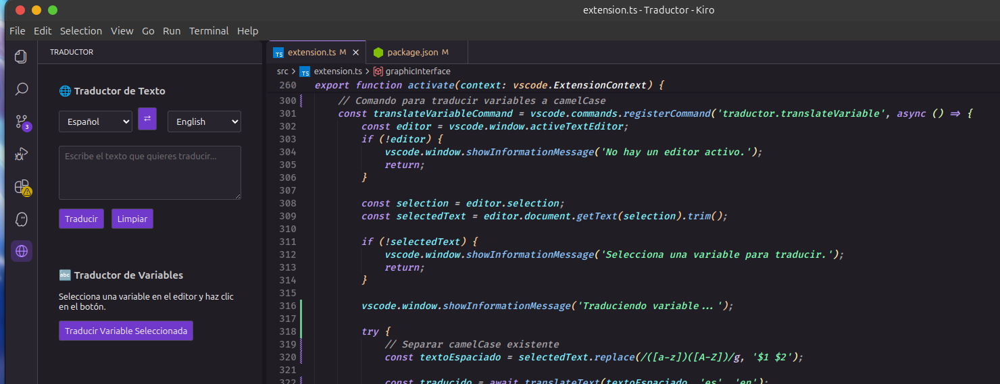
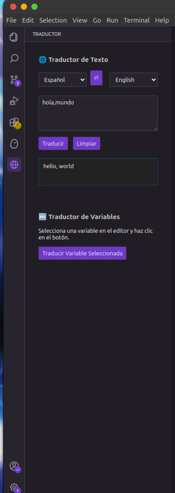

# Traductor de Vscode 

## Características

- Soporte para múltiples idiomas que hacen tu código más accesible 
- Interfaz intuitiva que se integra perfectamente con tu flujo de trabajo 
- Actualizaciones regulares con nuevas funcionalidades 
## Instalación
1. Abre VS Code
2. Ve a la pestaña de extensiones (Ctrl+Shift+X)
3. Busca "Traductor de VSCode"
4. Haz clic en instalar

## Futuras Actualizaciones 

1. Leer archivos a tiempo real 
2. Detectar palabra en español y traducirla automaticamente a ingles a tiempo real
3.Integracion con Inteligencia artificial

## Futura Actualizacion de lenguajes y framWorks
1.React

## Uso
1. Selecciona el texto que deseas traducir
2. Presiona Ctrl+Alt+T o haz clic derecho y selecciona "Traducir"
3. Elige el idioma de destino
4. ¡Disfruta de tu texto traducido!

## Soporte
Si encuentras algún problema o tienes sugerencias, por favor:
- Abre un issue en nuestro [repositorio de GitHub](https://github.com/usuario/traductor-vscode)
- Envía un correo a soporte@traductordevscode.com

## Licencia
Este proyecto está licenciado bajo la Licencia MIT - ver el archivo LICENSE para más detalles.
## Imágenes

## Video Tutorial

*[Ver video completo en nuestra galería](https://example.com/galeria-videos)*
